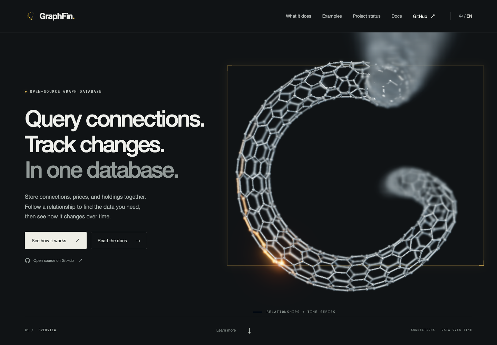

# Round G: denser Fuller Lattice selected

Approved implementation brief, 1 October 2026. Optical, material, foreground
curve, and final Fuller selection/density revisions, 2 October 2026.

The user approved developing both forms before deciding which to retain:
a fuller carbon lattice with a round cross-section, and a thin open ribbon.
Both must have a rounder G silhouette, an upper-right tip projecting toward
the viewer, and a central tip receding behind the screen plane. Real camera
depth must remain visible. Gentle dynamic perspective and evolving signal
speed should make the page feel more alive. Remove the pause-animation button.

The 2 October feedback asks for the foreground arm to remain legible longer,
a stronger sense of coming out of the screen, and a reflective metal finish.
Both variants now use polished silver-grey metal on the same lattice topology.

## Review the result

The user selected Fuller Lattice as the only public visualization on 2 October,
and requested a denser structure. The main site at `/graphfin/` now always uses
Fuller, including old `?shape=ribbon` links, language changes, and all fallback
paths. This is the single entry built for GitHub Pages.

`/graphfin/research/g-comparison.html` remains available through `npm run dev`
for local research. Its reference ribbon, comparison HTML, and comparison script
are excluded from the production build. The Pages deployment uses a clean output,
so any previously published comparison is removed on the next deployment.



| Form | Desktop | Mobile | Status |
| --- | --- | --- | --- |
| Denser Fuller | 896 nodes / 1,344 bonds | 440 nodes / 660 bonds | Sole public visual |
| Approved Fuller checkpoint | 480 nodes / 720 bonds | 256 nodes / 384 bonds | Preserved in `fc145ea1` |
| Thin ribbon | 384 nodes / 528 bonds | 192 nodes / 256 bonds | Local research reference |

Current browser captures: [Fuller desktop](current/fuller-desktop.png) and
[Fuller mobile](current/fuller-mobile.png). Historical references:
[earlier comparison](current/comparison.png),
[ribbon desktop](current/ribbon-desktop.png), [ribbon mobile](current/ribbon-mobile.png).
These show the actual Three.js implementation. The earlier
[A concept](concepts/g-fuller.png) and [B concept](concepts/g-ribbon.png) are
imagegen studies, with [saved prompts](concepts/prompts.md); their photographic
detail is a reference, not a claim about the browser renderer.

## What the paper contributed

The shape paper usefully prioritizes silhouette at small sizes, depth-consistent
occlusion, deliberate terminals, restrained material variation, and mobile
legibility without post-processing. Those principles inform both implemented
forms. The new brief retains an open G with two distinct tips, so the proposed
closed torus, return bridge, central gold core, and phase-locked double pulse
are not adopted.

The paper's mathematical construction needs revision before it is treated as
an implementation specification. Its linear ribbon sweep does not identify
the two transverse edges as the “Single seam” proposition claims. Its claim
that a rotation-minimising frame closes by construction conflicts with the
later paragraph about residual holonomy. The `wang2008` bibliography label
also does not match the rotation-minimising-frame paper linked there. The
original PDF/TeX files are preserved as historical research; the equations
below describe the current code.

## Shared geometry and depth

The outer centerline is a 300-degree circle with radius 2.24 world units:

```text
u ∈ [0, 0.82]
angle = π/6 + (u / 0.82) × 5π/3
xy = 2.24 × (cos(angle), sin(angle))
```

A cubic Bézier segment continues from the lower-right arc into a short central
arm. Its first control point follows the circle tangent, making the visible
inward turn smooth. The circular arc and cubic share a tangent direction;
this is geometric tangent continuity, not a claim of equal parameter speed.

Positive z is toward the baseline camera. For the shared centerline:

```text
depth(u) = 2.62 × max(0, 1 − u/0.32)²
           − 2.57 × smoothstep(0.77, 1, u)
           + 0.36 × (0.5 − u)
```

The base curve runs from z = +2.8 to z = −2.75. It then continues past both
visible arms, with additional depth:

```text
nearExtension(u) = 18 × max(0, 1 − u/0.11)³
farExtension(u)  = 60 × smoothstep(0.92, 1, u)³
z(u) = depth(u) + nearExtension(u) − farExtension(u)
```

The camera starts around z = 10.3, with a far clip distance of 40. The actual
recycling ends lie behind the camera and beyond the far clip plane. They are
never visible tips. The parameter stream continuously subtracts from `u`,
carrying material from the rear central arm around the G and out toward the lens.
Material remains opaque throughout this movement.

Centerline xy uses the base depth to keep the focused loop round. The two
extensions receive no further perspective compensation: the foreground grows
and exits the sensor while the distant continuation shrinks. Sheet/tube width
and sphere radii retain their real perspective, overlap, and parallax.

Both forms sweep the same welded honeycomb nodes along that centerline.
An image-plane normal and its cross product with the 3D tangent form an
orthonormal sweep frame. A uses a circular section of radius 0.38, with welded
transverse topology. B uses an open sheet at width scale 0.145 per row coordinate,
with a gently varying lean. The main longitudinal route remains periodic for
the signal, while the renderer hides the seam-spanning bond that would connect
the two recycling ends across the aperture. `visibility(u)` is always 1;
there is no progress-dependent opacity fade.

Material phase is resampled by arc length through the visible depth range
(z = −6 to +8.5). This keeps the foreground hexagons evenly spaced as the arm
approaches the lens, instead of stretching a few cells into long streaks.
The hidden ends use a smaller phase allocation. Fuller now uses 64 longitudinal
columns and 7 circumferential rows on desktop, and 44 × 5 on mobile. The prior
48 × 5 and 32 × 4 budgets are preserved in checkpoint `fc145ea1`. This adds 87%
and 72% more cells respectively without changing the tube radius or G outline.
Node radii scale to 70% on desktop and 82% on mobile; bond radii scale to 82% and
90%. World-space and projected clearance checks still require the same safety
margins using the actual rendered radii. A lookup table is built once and reused
as the material flows. The research ribbon keeps its 48/32 longitudinal columns.

### Fuller foreground curve, after checkpoint `fc145ea1`

The approved metal/optics version is preserved in commit `fc145ea1`
(`feat(site): checkpoint approved fuller lattice`). The subsequent adjustment
gives the approaching Fuller Lattice arm a small inward sweep:

```text
curl(u) = (1 − smoothstep(0, 0.15, u))²
offsetXY = (−0.36, +0.12) × curl(u)
```

The offset eases into the round body without a tangent discontinuity. Depth,
focus, material, and transport direction retain the approved settings. Each
variant has its own arc-length lookup so spacing remains even along the new
curve. The ribbon keeps its earlier centerline as a research reference.

## Optical cutoff revision

The earlier blur used a few fixed-offset taps and retained the sharp centre
sample. This left repeated outlines and a hard underlying silhouette. Fading
the endpoints also removed material instead of spreading its light, producing
the artificial cutoff identified in review.

The replacement `focus-pass.ts` uses view-space distance and a thin-lens circle
of confusion. With aperture radius `a = 0.3`, focal distance `f`, object distance
`d`, and vertical field of view 40 degrees, its image radius in viewport heights is:

```text
CoC = a / (2 × tan(20°)) × |1/d − 1/f|
```

Focus tracks a plane 0.6 world units in front of the middle of the G. Reducing
the aperture from 0.7 to 0.3 keeps the approaching lattice legible longer; blur
still grows naturally as it gets close to the lens. At a 600-pixel image height,
the middle arc has less than 1 pixel of Gaussian sigma and the forward arm at
distance 8.8 has less than 1.5 pixels. Near defocus expands faster than far defocus.
The aperture profile is a soft Gaussian approximation, with sigma equal to half
the circle radius. Eight overlapping radius bands spread premultiplied linear
colour and coverage together; their weights sum to one. Separable convolution
and mip prefiltering avoid sparse sample ghosts and unstable subpixel wires.
The sharp contribution goes to zero as defocus grows. Blur size scales with
the viewport, so mobile uses the same optical treatment; desktop also has bloom.
The band targets are allocated on resize and reused while animation runs.

This is a real-time image-space approximation, not aperture ray tracing. It
does not reconstruct surfaces hidden behind an opaque foreground object, and
the soft aperture does not produce hard-edged polygonal bokeh. Those limits are
less prominent in this open lattice than on solid overlapping objects.

Reference: [NVIDIA GPU Gems 3, Chapter 28](https://developer.nvidia.com/gpugems/gpugems3/part-iv-image-effects/chapter-28-practical-post-process-depth-field),
especially the thin-lens model and the discussion of foreground silhouettes.
The geometry extensions, banded filtering, and tuning above are project choices.

## Camera, light, and motion

The perspective camera keeps its 40-degree field of view. Automatic horizontal
travel is at most 0.6 world units, vertical travel 0.24, with a slow small dolly
and damped pointer parallax (0.34 horizontal / 0.18 vertical) on desktop.
Mobile automatic travel is 35% of that
amplitude and pointer parallax is disabled. The excursion is intentionally
small so the letter stays readable and the near/far depth ordering does not
swap roles. The lattice flow stays on even while the signal changes speed or
briefly stalls.

The lattice uses a silver-grey base, metalness near 1, and roughness near 0.2
with restrained surface variation. A sharper studio environment produces
reflected light strips, supported by a warm key and cool rim. The previous
emissive outlines on inactive metal are removed: its highlights now respond to
surface orientation, camera movement, and the environment. Only the travelling
amber signal emits light. Atmospheric fog is removed.

Perspective growth, overlap with the screen frame, motion parallax, and changing
reflections supply the depth cues before the foreground reaches strong defocus.
This creates a monocular 3D illusion on an ordinary display, rather than separate
stereoscopic views for each eye. Mobile omits bloom but preserves depth of field.
The material follows Three.js's
[metallic-roughness model](https://threejs.org/docs/pages/MeshStandardMaterial.html)
with a prefiltered environment; this remains a real-time approximation.

The gold signal advances by integrating a changing speed envelope. A smooth
pace multiplier supplements the existing surges, hesitations, thermal trail,
and occasional stalls. This changes speed continuously without teleporting
the head. Small damped mesh rotations and local flex add secondary movement.

The manual pause button and its controller API are removed. The flow and signal
are always on during an active page. The system's reduced-motion preference
freezes camera, lattice motion, and signal; hidden/offscreen scenes also stop
rendering to avoid wasting GPU work. Returning does not jump
the animation clock. Resize preserves signal progress and forward-flow phase.

## Fallback and verification

The public site always uses `current/fuller-fallback.png` if WebGL, renderer
import, or the context fails; that image is also in the HTML for no-JavaScript
use. It is captured from the production renderer at a reproducible initial
phase with reduced motion enabled, with a transparent background and separate
decorative frame. The local comparison retains the earlier ribbon fallback.

The browser capture test writes review images to test results normally.
`UPDATE_VISUALS=1` explicitly refreshes the checked-in Fuller previews and
fallback; rebuild afterward to include the new fallback in the Pages artifact.
The local comparison's `?still=1` remains a research capture aid only.

Geometry checks cover both variants and quality tiers, degree/route topology,
signal continuity over four minutes, roundness at the baseline projection,
recycling boundaries outside the camera across two minutes of movement, optical
near/far behaviour, absence of material fading, and node clearance.
Browser checks cover the sole Fuller site, legacy shape URLs, language and
quality changes, exclusion of the comparison/ribbon from the Pages artifact,
reduced motion, hidden/offscreen render gating, WebGL failure, context loss,
and no-JavaScript content.

Desktop targets 30 fps at DPR ≤ 1.75; mobile targets 24 fps at DPR ≤ 1.35.
The comparison runs two small scenes, so it costs more than a single hero.
Browser checks use software WebGL for reproducibility and do not establish
real-device frame rates. The lattice is a stylized visual model rather than
a chemically exact graphene structure or a path-traced product photograph.
